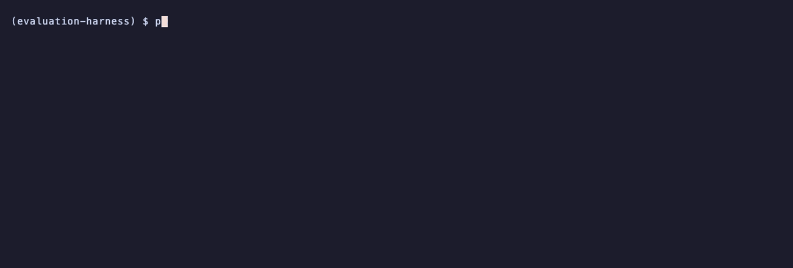
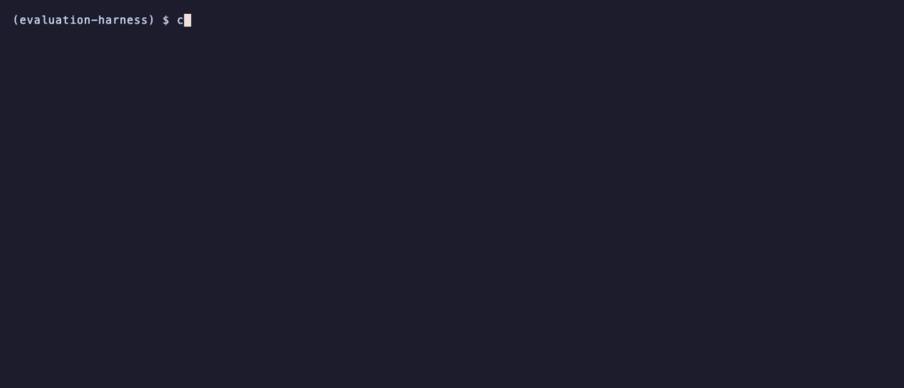

<h1 align="center">Evaluation Harness</h1>

<p align="center">
  <em>A from-scratch evaluation and benchmarking framework for large language models and agents.</em>
</p>

<p align="center">
  <a href="https://github.com/adeoluo/evaluation-harness/actions/workflows/ci.yml"></a>
  <a href="https://github.com/adeoluo/evaluation-harness/releases"></a>
  
  <a href="LICENSE"></a>
</p>

---

## Motivation

A single accuracy number is not a result; its uncertainty is. Most model comparisons
report one figure with no confidence interval, no baseline, and no check that the test
set leaked into training. This framework treats evaluation as a measurement discipline:
every metric ships with a **bootstrap confidence interval**, every task runs against a
**baseline**, and every benchmark can be scanned for **contamination**.

It is built from scratch (no evaluation-framework dependency) around five small,
composable abstractions, and it runs **fully offline** so results are reproducible and
continuous integration is hermetic. Frontier-provider adapters are optional add-ons.

## Architecture

<p align="center">
  
</p>

<sub>Legend: amber = entry points and external systems, indigo = core logic, green = data and state, blue = validation and control, grey = observability and outputs.</sub>

A **Runner** executes a **Model** over a **Task** (examples plus a **Grader**), timing
and scoring each example. Per-example scores are aggregated by the **bootstrap
statistics** layer into a mean with a confidence interval, then rendered as a text table
or JSON. A **contamination** scan independently checks task examples against a reference
corpus. Models and tasks are produced by small **registries**, so the command-line
interface and the HTTP service (which validates each request and records per-route
metrics) stay declarative. Saved **run records** feed regression detection between a
baseline and a candidate run. See the [architecture decision records](docs/adr/) for the
reasoning behind key choices.

### Capabilities

The measurement toolkit, all offline and from scratch:

- **16 graders** across every task family: exact match, includes, regex, fuzzy
  (edit distance), numeric tolerance, multiple choice, token F1, ROUGE-L, set and
  ordered-list matching, JSON validity and field extraction, rubric model-grading, and
  composite graders (any / all / weighted) that combine the rest.
- **Statistical rigor**: bootstrap confidence intervals on every metric, plus paired
  significance testing (paired bootstrap and the exact McNemar test) and Cohen's d effect
  size for comparing two models on the same examples.
- **Production runner**: optional thread-pool **concurrency**, **retries** with
  exponential backoff, and a **caching** model wrapper that memoizes predictions (with
  optional disk persistence).
- **Cumulative evaluation**: lossless **run records** (save/load to JSON), automatic
  **regression detection** between a baseline and a candidate run (per-task deltas and
  per-example flips), and **contamination** scanning via n-gram containment.
- **Reporting**: aligned text tables, Markdown, self-contained HTML, JSON with per-example
  records, and an error-analysis view that surfaces the worst examples.
- **4 bundled tasks** (arithmetic, sentiment, 3-way entailment, factual QA) with
  transparent baselines and heuristics, plus optional OpenAI and Anthropic adapters.

## Results

> Reproduce with `make evaluation`. Scores are mean +/- 95% bootstrap confidence interval.

| Task | Model | Accuracy (95% CI) | N |
|---|---|---:|---:|
| arithmetic | `arithmetic-solver` | **100.0% +/- 0.0%** | 60 |
| arithmetic | `constant-zero` (baseline) | 0.0% +/- 0.0% | 60 |
| sentiment | `keyword-sentiment` | **91.7% +/- 7.3%** | 48 |
| sentiment | majority-class (baseline) | 50.0% +/- 14.6% | 48 |
| entailment | `overlap-entailment` | **50.0% +/- 16.7%** | 30 |
| factual_qa | oracle (F1 upper bound) | **100.0% +/- 0.0%** | 25 |

The `compare` command additionally reports significance. For example,
`keyword-sentiment` versus the majority baseline on sentiment: **p < 0.0001**, Cohen's
d = **0.84**, a large, significant difference, not noise.

The numbers demonstrate the framework's central promise: it cleanly separates a real
solver from a weak baseline, and the lexicon sentiment model's visible interval reflects
its genuine errors on the negation examples in the benchmark.

### Scale

To check that the core evaluation loop holds up on large datasets, `benchmarks/scale.py`
runs the `arithmetic-solver` over deterministically generated arithmetic tasks at
growing sizes, timing `Runner.run` and tracking peak memory with the standard-library
`tracemalloc`. The data is synthetic and the numbers are environment-specific, but the
shape is the point: throughput stays roughly flat and memory grows linearly with the
number of examples, while grading accuracy stays at 100% because the solver is exact.

| Examples | Wall-clock (s) | Throughput (examples/s) | Peak memory (MiB) | Accuracy |
|---:|---:|---:|---:|---:|
| 2,000 | 0.046 | ~43,900 | 1.18 | 100.0% |
| 8,000 | 0.178 | ~45,100 | 4.69 | 100.0% |
| 32,000 | 0.707 | ~45,200 | 18.86 | 100.0% |
| 64,000 | 1.884 | ~34,000 | 37.76 | 100.0% |
| 128,000 | 3.509 | ~36,500 | 75.60 | 100.0% |

Reproduce with `uv run python benchmarks/scale.py`. The sweep now extends to **128,000 examples**,
where the loop still grades at 100% accuracy and peak memory grows linearly with the dataset
(~0.6 KiB/example).

### Independent validation against scipy

The statistics are written from scratch, so correctness is only credible if it agrees with an
established reference. `tests/test_scipy_parity.py` cross-checks every quantity against
[`scipy.stats`](https://docs.scipy.org/doc/scipy/reference/stats.html) on shared synthetic data:

| From-scratch quantity | scipy reference | Measured agreement |
|---|---|---|
| **Cohen's d** (paired) | `ttest_rel().statistic / sqrt(n)` | max abs diff **2.2e-16** |
| **McNemar exact p-value** | `binomtest(min, n, 0.5)` two-sided | max abs diff **1.1e-16** |
| **Bootstrap 95% CI** | `stats.bootstrap(method="percentile")` | max bound diff **0.0014** |
| **Paired bootstrap p-value** | `ttest_rel().pvalue` | same decision on every case; max abs diff **0.004** |

Cohen's d and the McNemar test match the reference to **machine precision**; the two Monte-Carlo
quantities (the bootstrap interval and the paired bootstrap p-value) agree within sampling noise and
reach the same significance decision as scipy on every case. This validates the hand-written
statistics against a standard library rather than against themselves. `scipy` is an opt-in
`validation` dependency (not a runtime dependency), so the significance code stays reference-free and
default CI skips the test via `pytest.importorskip`:

```bash
uv sync --group validation && uv run pytest tests/test_scipy_parity.py
```

### Performance

> Measured with `uv run python benchmarks/benchmark.py`.

| Operation | Throughput |
|---|---:|
| Model evaluation (grade + collect) | ~120,000 examples / sec |
| Bootstrap confidence interval (10k resamples) | ~257 intervals / sec |
| Paired significance test (10k resamples) | ~288 tests / sec |

Evaluation is offline and in-process; a full benchmark with statistical rigor runs in
milliseconds.

### Evaluation methodology

The bundled tasks are deliberately small and transparent so the published numbers are
reproducible on any machine in seconds:

- **arithmetic**: deterministic, seed-generated two-operand problems, numerically graded.
- **sentiment**: binary classification over a bundled dataset that includes negation and
  mixed-polarity sentences, a known failure mode for lexicon classifiers.

Full methodology, seeds, and per-model numbers are in
[docs/EVALUATION_REPORT.md](docs/EVALUATION_REPORT.md).

## Quickstart

```bash
git clone https://github.com/adeoluo/evaluation-harness.git && cd evaluation-harness
make setup                    # install dependencies + pre-commit hooks
make all                      # lint + type-check + test

# list built-in tasks and models
uv run python -m evaluation_harness list

# evaluate a model on one or more tasks
uv run python -m evaluation_harness run --model keyword-sentiment --task sentiment
uv run python -m evaluation_harness run \
    --model arithmetic-solver --task arithmetic --json report.json

# compare two models with a significance test
uv run python -m evaluation_harness compare \
    --model-a keyword-sentiment --model-b constant-positive --task sentiment
```

Evaluate a frontier model by installing its optional extra and setting an API key:

```bash
uv sync --extra openai      # or: --extra anthropic
export OPENAI_API_KEY=...
```

## Usage

A real run: the registered tasks and models, then an evaluation with a 95% confidence interval. Regenerate with `vhs docs/demo/run.tape`.

<p align="center">
  
</p>

### HTTP service

A standard-library HTTP service evaluates models on tasks and compares two models with a
significance test:

```bash
python -m evaluation_harness serve --port 8000

curl localhost:8000/health
curl -s -X POST localhost:8000/evaluate -d '{"model": "arithmetic-solver", "tasks": ["arithmetic"]}'
curl -s -X POST localhost:8000/compare -d '{"model_a": "arithmetic-solver", "model_b": "constant-zero", "task": "arithmetic"}'
```

`POST /evaluate` returns per-task accuracy with a bootstrap confidence interval; `POST
/compare` returns both accuracies, a p-value, an effect size, and a significance verdict. A
production-style stress benchmark (`uv run python benchmarks/stress.py`) reports throughput
and p50/p95/p99 latency; notably, throughput here *scales with threads* because the numeric
bootstrap releases the global interpreter lock, unlike the CPU-bound Python services elsewhere in
this portfolio. The service also exposes `GET /ready` (readiness) and `GET /metrics` (per-route
request, error, and latency metrics in Prometheus text format). See the
[operations guide](docs/OPERATIONS.md), the [scaling and tradeoffs](docs/SCALING.md) document,
and the [case study](docs/CASE_STUDY.md) on defending the claim that one model is better than
another.

### Demos

Recorded from real runs with [vhs](https://github.com/charmbracelet/vhs); each tape is in `docs/demo/`.

Two models on the same task, then the arithmetic task.

<p align="center">
  
</p>

The HTTP service comparing two models on the same task with a paired test.

<p align="center">
  
</p>

## Design decisions

- **Bootstrap intervals, not the normal approximation.** Evaluation scores are bounded
  and often bimodal (pass/fail), where the normal standard error is unreliable on small
  benchmarks. Resampling is reproducible under a fixed seed.
  ([ADR-0002](docs/adr/0002-bootstrap-confidence-intervals.md))
- **Containment, not Jaccard, for contamination.** An example can be fully contained in a
  much larger corpus; symmetric similarity would wash that signal out.
  ([ADR-0003](docs/adr/0003-ngram-containment-for-contamination.md))
- **Structural `Protocol` typing for models and graders.** Any object with the right
  shape is a first-class citizen, so API wrappers, local models, and deterministic stubs
  are evaluated identically and the framework stays open for extension.
- **Offline-first.** The whole pipeline runs with no network; provider SDKs are lazily
  imported so a missing one yields an actionable error rather than a hard dependency.

## Testing

```bash
make test        # uv run pytest
make coverage    # pytest with an 80% coverage gate, as in CI
make lint type   # ruff format check, ruff lint, mypy
```

The suite in `tests/` has unit tests for every grader (`test_graders.py`, `test_advanced_graders.py`, `test_model_graded.py`), the bootstrap statistics and significance tests (`test_statistics.py`, `test_significance.py`), the runner including concurrency, retries, and caching (`test_runner.py`, `test_runner_concurrency.py`), models, tasks, contamination scanning, run persistence and reporting, the command-line interface, and the HTTP handler layer (`test_service.py`).

`tests/test_scipy_parity.py` cross-checks the statistics against `scipy.stats`. It needs the opt-in `validation` dependency group and is skipped in default CI:

```bash
uv sync --group validation && uv run pytest tests/test_scipy_parity.py
```

CI runs ruff format, ruff lint, mypy, and pytest with the coverage gate on Python 3.11 and 3.12, then builds the package and the Docker image.

## Responsible AI

- **Model card:** [docs/MODEL_CARD.md](docs/MODEL_CARD.md)
- **Data card:** [docs/DATA_CARD.md](docs/DATA_CARD.md)
- **Threat model:** [docs/THREAT_MODEL.md](docs/THREAT_MODEL.md)

## Limitations

- The bundled tasks demonstrate the framework; they are not competitive benchmarks. The
  value is the measurement machinery, which accepts any task and grader.
- Model-graded scoring is only as reliable as the judge model; validate it against human
  labels before trusting it (see the evaluation report).
- Contamination detection is n-gram based and will miss paraphrased leakage.

## Roadmap

- [ ] Concurrent generation for provider-backed models
- [ ] Per-category score breakdowns and error-analysis export
- [ ] Additional graders (F1 for extractive answers, pass@k for code)

## License

Released under the [MIT License](LICENSE).
