<h1 align="center">Evaluation Harness</h1>

<p align="center">
  <em>A principled, from-scratch evaluation and benchmarking framework for large language models and agents.</em>
</p>

<p align="center">
  <a href="https://github.com/adeoluo/evaluation-harness/actions/workflows/ci.yml"></a>
  
  
  
  
</p>

---

## Motivation

A single accuracy number is not a result - its uncertainty is. Most model comparisons
report one figure with no confidence interval, no baseline, and no check that the test
set leaked into training. This framework treats evaluation as a measurement discipline:
every metric ships with a **bootstrap confidence interval**, every task runs against a
**baseline**, and every benchmark can be scanned for **contamination**.

It is built from first principles (no evaluation-framework dependency) around five small,
composable abstractions, and it runs **fully offline** so results are reproducible and
continuous integration is hermetic. Frontier-provider adapters are optional add-ons.

## Architecture

<p align="center">
  
</p>

A **Runner** executes a **Model** over a **Task** (examples plus a **Grader**), timing
and scoring each example. Per-example scores are aggregated by the **bootstrap
statistics** layer into a mean with a confidence interval, then rendered as a text table
or JSON. A **contamination** scan independently checks task examples against a reference
corpus. Models and tasks are produced by small **registries**, so the command-line
interface stays declarative. See the [architecture decision records](docs/adr/) for the
reasoning behind key choices.

## Results

> Reproduce with `make evaluation`. Scores are mean +/- 95% bootstrap confidence interval.

| Task | Model | Accuracy (95% CI) | N |
|---|---|---:|---:|
| arithmetic | `arithmetic-solver` | **100.0% +/- 0.0%** | 60 |
| arithmetic | `constant-zero` (baseline) | 0.0% +/- 0.0% | 60 |
| sentiment | `keyword-sentiment` | **91.7% +/- 7.3%** | 48 |
| sentiment | majority-class (baseline) | 50.0% +/- 14.6% | 48 |

The numbers demonstrate the framework's central promise: it cleanly separates a real
solver from a weak baseline, and the lexicon sentiment model's visible interval reflects
its genuine errors on the negation examples in the benchmark.

## Quickstart

```bash
git clone https://github.com/adeoluo/evaluation-harness.git && cd evaluation-harness
make setup                    # install dependencies + pre-commit hooks
make all                      # lint + type-check + test

# list built-in tasks and models
uv run python -m evaluation_harness list

# evaluate a model on one or more tasks
uv run python -m evaluation_harness run --model keyword-sentiment --task sentiment
uv run python -m evaluation_harness run \
    --model arithmetic-solver --task arithmetic --json report.json
```

Evaluate a frontier model by installing its optional extra and setting an API key:

```bash
uv sync --extra openai      # or: --extra anthropic
export OPENAI_API_KEY=...
```

## Design decisions

- **Bootstrap intervals, not the normal approximation.** Evaluation scores are bounded
  and often bimodal (pass/fail), where the normal standard error is unreliable on small
  benchmarks. Resampling is reproducible under a fixed seed.
  ([ADR-0002](docs/adr/0002-bootstrap-confidence-intervals.md))
- **Containment, not Jaccard, for contamination.** An example can be fully contained in a
  much larger corpus; symmetric similarity would wash that signal out.
  ([ADR-0003](docs/adr/0003-ngram-containment-for-contamination.md))
- **Structural `Protocol` typing for models and graders.** Any object with the right
  shape is a first-class citizen, so API wrappers, local models, and deterministic stubs
  are evaluated identically and the framework stays open for extension.
- **Offline-first.** The whole pipeline runs with no network; provider SDKs are lazily
  imported so a missing one yields an actionable error rather than a hard dependency.

## Evaluation

The bundled tasks are deliberately small and transparent so the published numbers are
reproducible on any machine in seconds:

- **arithmetic** - deterministic, seed-generated two-operand problems, numerically graded.
- **sentiment** - binary classification over a bundled dataset that includes negation and
  mixed-polarity sentences, a known failure mode for lexicon classifiers.

Full methodology, seeds, and per-model numbers are in
[docs/EVALUATION_REPORT.md](docs/EVALUATION_REPORT.md).

## Responsible AI

- **Model card:** [docs/MODEL_CARD.md](docs/MODEL_CARD.md)
- **Data card:** [docs/DATA_CARD.md](docs/DATA_CARD.md)
- **Threat model:** [docs/THREAT_MODEL.md](docs/THREAT_MODEL.md)

## Limitations

- The bundled tasks demonstrate the framework; they are not competitive benchmarks. The
  value is the measurement machinery, which accepts any task and grader.
- Model-graded scoring is only as reliable as the judge model; validate it against human
  labels before trusting it (see the evaluation report).
- Contamination detection is n-gram based and will miss paraphrased leakage.

## Roadmap

- [ ] Concurrent generation for provider-backed models
- [ ] Per-category score breakdowns and error-analysis export
- [ ] Additional graders (F1 for extractive answers, pass@k for code)

## License

[MIT](LICENSE). Part of a 28-project artificial intelligence engineering portfolio by
[adeoluo](https://github.com/adeoluo).
