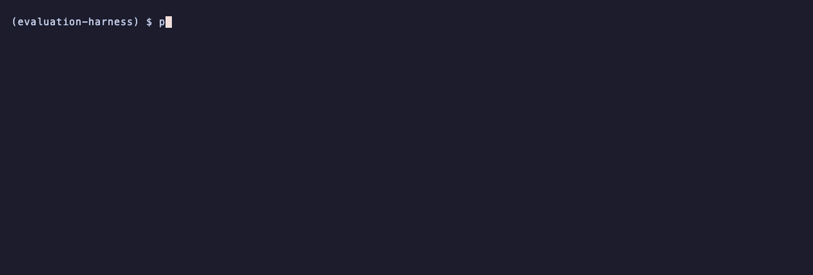
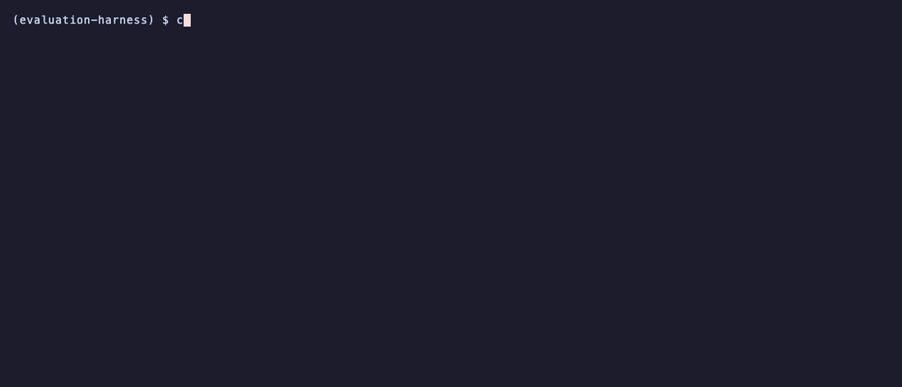

<h1 align="center">Evaluation Harness</h1>

<p align="center">
  <em>A Python framework, written from scratch, that tests large language models (LLMs) and agents and reports each score with an error bar.</em>
</p>

<p align="center">
  <a href="https://github.com/adeoluo/evaluation-harness/actions/workflows/ci.yml"></a>
  <a href="https://github.com/adeoluo/evaluation-harness/releases"></a>
  
  <a href="LICENSE"></a>
</p>

---

> **Evidence level: reference validated.** The statistics are checked against SciPy, the standard Python library for scientific computing. The bundled tasks use heuristic models (simple rule-based programs), not real LLMs. No one else has reproduced the results, and the framework is not used in production.

## Highlights

When an AI model gets a higher test score, the gain may be real or may be chance. This
toolkit runs the tests and reports which of the two it is.

- **It has 16 ways to grade an answer.** They range from an exact text match to fuzzy
  matching, which allows small differences, and pattern matching.
- **Each task score in the results comes with an error bar, and two models are compared
  with paired significance tests.** On the sentiment task, the keyword model scores 91.7%
  accuracy (share answered correctly, higher is better), compared with 50.0% for a baseline
  that always answers "positive". The p-value is below 0.0001 (lower is stronger evidence),
  so the gap is very unlikely to be chance.
- **The statistics match SciPy.** Two results agree with SciPy to about 16 decimal places:
  the effect size (Cohen's d, where a larger value means a bigger difference) and the
  McNemar test (a pass-or-fail comparison of two models). This is the limit of how precisely
  a computer stores decimal numbers.

**Where it falls short:** the bundled example tasks use simple rule-based stand-ins, not real
language models. Adapters for OpenAI and Anthropic models are included but optional, and no
result in this README comes from them.

## Key terms

Plain definitions of the terms used in this README.

| Term | Meaning |
|---|---|
| Accuracy | The share of a task's examples that a model answers correctly, from 0% to 100%. Higher is better. With partial-credit graders it is the mean grade. |
| Baseline | A deliberately weak model used for comparison, for example one that always gives the same answer. A useful model must clearly beat it. |
| Bootstrap | A way to estimate uncertainty: resample the examples many times, with replacement, and recompute the score each time. This project uses 10,000 resamples by default. |
| Cohen's d | An effect size: the mean per-example difference between two models, divided by the spread of those differences. 0 means no difference. By convention, at least 0.8 is large. |
| Confidence interval (CI) | A range that likely contains the true score. This README shows the mean plus or minus half the width of a 95% interval. Narrower means more certain. |
| Contamination | Test examples that also appear in a model's training data. A contaminated test makes a model look better than it really is. |
| Entailment | A task that decides whether one sentence follows from another, contradicts it, or is neutral. The bundled entailment task has these three answer options. |
| Grader | A rule that scores one model answer against the reference answer, from 0 (wrong) to 1 (correct). This project has 16 graders. |
| Heuristic model | A simple rule-based program that stands in for a real language model, such as a keyword list for sentiment. All bundled results use such models. |
| Large language model (LLM) | A neural network trained on very large amounts of text that writes text answers to prompts. |
| Machine precision | The smallest relative difference that 64-bit floating-point numbers, the usual computer format for decimals, can show: about 2.2e-16. Results this close are equal in practice. |
| McNemar test | An exact significance test for two models graded pass or fail on the same examples. It uses only the examples where exactly one model is correct. |
| N | The number of examples in a task. |
| N-gram containment | The share of an example's n-grams (runs of n consecutive words) that also appear in a reference text collection, from 0 to 1. Higher suggests contamination. |
| Oracle | A test model that returns the reference answer. A correct grader must give it 100%, so it checks the grader, not a model. |
| p-value | The probability of a difference at least this large if the two models were equally good, from 0 to 1. Lower is stronger evidence. Below 0.05 counts as significant here. |
| Paired bootstrap test | A significance test that resamples the per-example score differences between two models. It works for any score from 0 to 1, including partial credit. |
| Peak memory | The most memory a run used at any moment, in mebibytes (MiB, 1,048,576 bytes). Lower is better. |
| Percentile latency (p50, p95, p99) | The response time that 50%, 95% or 99% of requests stay under. Lower is better. p50 is the median. |
| Regression detection | A comparison of a new run with an earlier baseline run. It flags tasks whose accuracy dropped and examples that changed from correct to wrong. |
| SciPy | The standard Python library for scientific computing. Its `scipy.stats` module is the reference used here to check the statistics. |
| Statistical significance | A difference is significant when it is unlikely to be chance. In this project that means a p-value below 0.05. |
| Throughput | How many examples, requests or operations finish per second. Higher is better. |
| Token F1 | A partial-credit score for the word overlap between an answer and the reference, from 0 to 1. Higher is better. The factual QA task is graded with it. |
| Wall-clock time | The real time a run takes, in seconds. Lower is better. |

## Motivation

A single accuracy number is not a result. The result also needs a measure of how
uncertain that number is. Most model comparisons report one figure. They give no confidence
interval (a range that likely contains the true score), no baseline, and no check that the
test set leaked into the model's training data. This framework treats evaluation as a
measurement. Every task accuracy in the results comes with a **bootstrap confidence
interval**, estimated by resampling the examples many times. Three of the four bundled tasks
have a weak **baseline** model to compare against. Any task can be scanned for
**contamination**, which is this kind of leak.

It is built from scratch, with no dependency on another evaluation framework. It has five
small building blocks that fit together: an example, a model, a grader, a task and a runner.
It runs **fully offline**, so results are reproducible. For the same reason, continuous
integration (CI, the automatic checks that run on every change) does not depend on any
outside service. Adapters for frontier models (large commercial models from providers such
as OpenAI and Anthropic) are optional add-ons.

## Architecture

<p align="center">
  
</p>

<sub>Legend: amber marks entry points and external systems, indigo marks core logic, green marks data and state, blue marks validation and control, and grey marks monitoring and outputs.</sub>

A **Runner** runs a **Model** on a **Task**. A task is a set of examples plus a **Grader**.
The runner times and scores each example. The **bootstrap statistics** layer combines the
per-example scores into a mean with a confidence interval. The result is shown as a text
table or as JSON (a common text format for structured data). A **contamination** scan
separately checks task examples against a reference corpus, a collection of texts such as a
sample of training data. Small **registries** (lookup tables from a name to a model or a
task) build models and tasks by name. So the command-line interface and the HTTP service
only declare what to run. The HTTP service is a small web server. It also validates each
request and records metrics for each route. Saved **run records** feed regression detection
between a baseline run and a candidate run. See the
[architecture decision records](docs/adr/) (ADRs) for the reasoning behind key choices.

### Capabilities

The measurement toolkit. All of it runs offline and is written from scratch.

- **16 graders** for the common kinds of evaluation task. The text graders are exact match,
  includes (the answer contains the target), regex (a text pattern) and fuzzy match. Fuzzy
  match allows small differences, measured by edit distance (the number of single-character
  changes). Other graders check a number within a set margin, multiple choice, token F1
  (word overlap), ROUGE-L (the longest shared word sequence), set and ordered-list matching,
  JSON validity and JSON field extraction. A rubric grader uses a judge model. Three
  composite graders (any, all, weighted) combine the others.
- **Statistics**: a bootstrap confidence interval on every task accuracy. Two models scored
  on the same examples can be compared with paired significance tests (the paired
  bootstrap and the exact McNemar test). Cohen's d gives the size of the difference.
- **Runner for real workloads**: optional parallel threads (**concurrency**), **retries**
  with exponential backoff (the wait doubles after each failed attempt), and a **caching**
  model wrapper. The cache stores each prediction so it is not generated again, and it can
  be saved to disk.
- **Cumulative evaluation**: **run records** save each example's input, reference answer,
  prediction, score and timing to JSON and load them back. Automatic **regression
  detection** compares a baseline run with a candidate run. It reports the accuracy change
  per task and the examples that flipped between correct and wrong. **Contamination**
  scanning uses n-gram containment: the share of an example's n-grams (runs of n
  consecutive words) that also appear in a reference text collection.
- **Reporting**: aligned text tables, Markdown, self-contained HTML, JSON with a record for
  each example, and an error-analysis view that lists the lowest-scoring examples.
- **4 bundled tasks**: arithmetic, sentiment, 3-way entailment and factual question
  answering (QA). They come with transparent baselines and rule-based models, plus optional
  OpenAI and Anthropic adapters.

## Results

> Reproduce with `make evaluation` (make runs the project's predefined commands). Each score is the mean, plus or minus half the width of the 95% bootstrap confidence interval.

Each row shows one built-in model on one bundled task, and the accuracy column gives the share
of the task's N examples it answered correctly (higher is better). The number after +/- is
the error bar, so a smaller number means a more certain score.

| Task | Model | Accuracy (95% CI) | N |
|---|---|---:|---:|
| arithmetic | `arithmetic-solver` | **100.0% +/- 0.0%** | 60 |
| arithmetic | `constant-zero` (baseline) | 0.0% +/- 0.0% | 60 |
| sentiment | `keyword-sentiment` | **91.7% +/- 7.3%** | 48 |
| sentiment | `constant-positive` (majority-class baseline) | 50.0% +/- 14.6% | 48 |
| entailment | `overlap-entailment` | **50.0% +/- 16.7%** | 30 |
| factual_qa | `oracle` (returns the reference answer; checks the grader) | **100.0% +/- 0.0%** | 25 |

The `compare` command also runs a significance test on two models. For example, it
compares `keyword-sentiment` with the majority-class baseline (`constant-positive`, which
always answers positive) on the sentiment task. The p-value is below 0.0001
(**p < 0.0001**), and lower means stronger evidence. The effect size is Cohen's
d = **0.84**, which is large by the usual rule that at least 0.8 is large. So the
difference is significant and is not noise.

These numbers show the main purpose of the framework. It clearly separates a real solver
from a weak baseline. The sentiment model uses a word list (a lexicon). Its error bar is
not zero, and this reflects its real errors on the negation examples in the benchmark.

### Scale

This benchmark checks that the core evaluation loop still works on large datasets.
`benchmarks/scale.py` runs the `arithmetic-solver` model on generated arithmetic tasks of
growing size. The tasks come from a fixed seed, so every run uses the same data. The script
times `Runner.run` and measures peak memory (the most memory used at any moment) with
`tracemalloc`, a memory tracer in the Python standard library. The data is synthetic, and the
timings depend on the machine. The trend is what matters: throughput (examples graded per
second, higher is better) stays roughly flat, and memory grows in proportion to the number of
examples. Accuracy stays at 100% because the solver computes each answer exactly.

Each row is one dataset size. The columns give the wall-clock time (real elapsed time) and the
peak memory (lower is better for both), the throughput (higher is better) and the accuracy.

| Examples | Wall-clock (s) | Throughput (examples/s) | Peak memory (MiB) | Accuracy |
|---:|---:|---:|---:|---:|
| 2,000 | 0.046 | ~43,900 | 1.18 | 100.0% |
| 8,000 | 0.178 | ~45,100 | 4.69 | 100.0% |
| 32,000 | 0.707 | ~45,200 | 18.86 | 100.0% |
| 64,000 | 1.884 | ~34,000 | 37.76 | 100.0% |
| 128,000 | 3.509 | ~36,500 | 75.60 | 100.0% |

Reproduce with `uv run python benchmarks/scale.py` (uv is a Python package and environment
manager). The largest run has **128,000 examples**.
At that size the loop still grades with 100% accuracy. Peak memory grows in proportion to the
dataset, at about 0.6 KiB (kibibytes, 1,024 bytes each) per example.

### Independent validation against scipy

The statistics are written from scratch, so they are only credible if they agree with an
established reference. `tests/test_scipy_parity.py` checks each quantity in the table below
against [`scipy.stats`](https://docs.scipy.org/doc/scipy/reference/stats.html) on the same
generated test data.

Each row is one statistic computed by this project. The middle column names the SciPy
function used as the reference, and the last column gives the largest difference found
(smaller is better).

| From-scratch quantity | scipy reference | Measured agreement |
|---|---|---|
| **Cohen's d** (paired) | `ttest_rel().statistic / sqrt(n)` | max abs diff **2.2e-16** |
| **McNemar exact p-value** | `binomtest(min, n, 0.5)` two-sided | max abs diff **1.1e-16** |
| **Bootstrap 95% CI** | `stats.bootstrap(method="percentile")` | max bound diff **0.0014** |
| **Paired bootstrap p-value** | `ttest_rel().pvalue` | same decision on every case; max abs diff **0.004** |

Cohen's d and the McNemar test match SciPy to **machine precision**. The other two
quantities, the bootstrap interval and the paired bootstrap p-value, depend on random
resampling. They agree with SciPy within sampling noise. The paired bootstrap p-value also
reaches the same significance decision as SciPy in every test case. So the hand-written statistics are checked against a
standard library, not only against themselves. `scipy` is an opt-in `validation` dependency
group, not a runtime dependency, so the significance code does not rely on it. The main CI
test job skips this test through `pytest.importorskip`, a pytest feature (pytest is the
Python test runner) that skips a test when a library is missing. A separate CI job installs SciPy and
runs it. To run it locally:

```bash
uv sync --group validation && uv run pytest tests/test_scipy_parity.py
```

### Performance

> Measured with `uv run python benchmarks/benchmark.py`.

Each row is one operation, and the throughput column gives how many of them finish per second
(higher is better).

| Operation | Throughput |
|---|---:|
| Model evaluation (grade + collect) | ~120,000 examples / sec |
| Bootstrap confidence interval (10k resamples) | ~257 intervals / sec |
| Paired significance test (10k resamples) | ~288 tests / sec |

Evaluation runs offline, inside one Python process. A full benchmark run, including the
statistics, takes milliseconds.

### Evaluation methodology

The bundled tasks are small and easy to inspect on purpose. So the published numbers can be
reproduced on any machine in seconds:

- **arithmetic**: problems with two numbers, generated from a fixed seed and graded by
  numeric comparison.
- **sentiment**: positive-or-negative classification on a bundled dataset. It includes
  sentences with negation and sentences that mix positive and negative words. Word-list
  (lexicon) classifiers are known to fail on such sentences.

Full methodology, seeds, and per-model numbers are in
[docs/EVALUATION_REPORT.md](docs/EVALUATION_REPORT.md).

## Quickstart

```bash
git clone https://github.com/adeoluo/evaluation-harness.git && cd evaluation-harness
make setup                    # install dependencies + pre-commit hooks
make all                      # lint + type-check + test

# list built-in tasks and models
uv run python -m evaluation_harness list

# evaluate a model on one or more tasks
uv run python -m evaluation_harness run --model keyword-sentiment --task sentiment
uv run python -m evaluation_harness run \
    --model arithmetic-solver --task arithmetic --json report.json

# compare two models with a significance test
uv run python -m evaluation_harness compare \
    --model-a keyword-sentiment --model-b constant-positive --task sentiment
```

To evaluate a frontier model, install its optional extra and set an API key (the secret key
for the provider's application programming interface, or API):

```bash
uv sync --extra openai      # or: --extra anthropic
export OPENAI_API_KEY=...
```

## Usage

The recording below shows a real run. It lists the registered tasks and models, then runs an evaluation with a 95% confidence interval. Regenerate it with `vhs docs/demo/run.tape` (vhs is a tool that records terminal sessions as animations).

<p align="center">
  
</p>

### HTTP service

An HTTP service, built only with the Python standard library, evaluates models on tasks. It
also compares two models with a significance test:

```bash
python -m evaluation_harness serve --port 8000

curl localhost:8000/health
curl -s -X POST localhost:8000/evaluate -d '{"model": "arithmetic-solver", "tasks": ["arithmetic"]}'
curl -s -X POST localhost:8000/compare -d '{"model_a": "arithmetic-solver", "model_b": "constant-zero", "task": "arithmetic"}'
```

`POST /evaluate` returns the accuracy for each task with a bootstrap confidence interval.
`POST /compare` returns both accuracies, a p-value, an effect size and a significance
verdict. A stress benchmark that imitates production load
(`uv run python benchmarks/stress.py`) reports throughput and the p50, p95 and p99 latency.
These are the response times that 50%, 95% and 99% of requests stay under, and lower is
better. Here throughput *scales with threads*: it rises when more worker threads are added.
The reason is that the numeric bootstrap releases the global interpreter lock, the Python
lock that normally lets only one thread run at a time. The CPU-bound Python services (limited
by processor speed) elsewhere in this portfolio do not behave this way. The service also
offers `GET /ready` (a readiness check) and `GET /metrics`. The metrics route reports requests, errors and latency for each
route in the text format of Prometheus, a monitoring system. See the
[operations guide](docs/OPERATIONS.md), the [scaling and tradeoffs](docs/SCALING.md) document,
and the [case study](docs/CASE_STUDY.md). The case study explains how to defend the claim that
one model is better than another.

### Demos

These recordings come from real runs with [vhs](https://github.com/charmbracelet/vhs). Each tape (the vhs script for a recording) is in `docs/demo/`.

The first recording compares two models on the same task, then runs the arithmetic task.

<p align="center">
  
</p>

The second recording shows the HTTP service comparing two models on the same task with a paired test.

<p align="center">
  
</p>

## Design decisions

- **Bootstrap intervals, not the normal approximation.** Evaluation scores are bounded
  (between 0 and 1) and often bimodal, meaning most are either pass or fail. For such scores
  on small benchmarks, the standard error (the usual estimate of a mean's uncertainty) from
  the normal (bell-curve) approximation is unreliable. Resampling gives the same result
  every time under a fixed seed.
  ([ADR-0002](docs/adr/0002-bootstrap-confidence-intervals.md))
- **Containment, not Jaccard, for contamination.** An example can sit entirely inside a
  much larger corpus. Containment measures the share of the example found in the corpus.
  Jaccard similarity divides the overlap by the size of both texts together, so a large
  corpus would hide that signal.
  ([ADR-0003](docs/adr/0003-ngram-containment-for-contamination.md))
- **Structural `Protocol` typing for models and graders.** Python's `Protocol` type accepts
  any object that has the right methods and attributes. So API wrappers, local models and
  deterministic stubs (fixed test stand-ins) are all evaluated the same way. New kinds of
  model and grader can be added without changing the framework.
- **Offline-first.** The whole pipeline runs with no network. Provider SDKs (the client
  libraries for each provider's API) are imported only when needed. If one is missing, the
  user gets a clear error that says how to install it, so no SDK is a required dependency.

## Testing

```bash
make test        # uv run pytest
make coverage    # pytest with an 80% coverage gate, as in CI
make lint type   # ruff format check, ruff lint, mypy
```

The suite in `tests/` uses pytest. It has unit tests for every grader (`test_graders.py`, `test_advanced_graders.py`, `test_model_graded.py`). It tests the bootstrap statistics and the significance tests (`test_statistics.py`, `test_significance.py`). It tests the runner, including concurrency, retries and caching (`test_runner.py`, `test_runner_concurrency.py`). It also covers models, tasks, contamination scanning, saving runs, reporting, the command-line interface and the HTTP handler layer (`test_service.py`).

`tests/test_scipy_parity.py` checks the statistics against `scipy.stats`. It needs the opt-in `validation` dependency group. The main CI test job skips it, and a separate CI job installs SciPy and runs it:

```bash
uv sync --group validation && uv run pytest tests/test_scipy_parity.py
```

CI runs the ruff formatter and linter (a Python code checker), mypy (a type checker) and pytest with the coverage gate on Python 3.12, 3.13, 3.14 and 3.15. The coverage gate fails the run if the tests exercise less than 80% of the code. CI then builds the package and the Docker image (a packaged, runnable copy of the project).

## Responsible AI

- **Model card:** [docs/MODEL_CARD.md](docs/MODEL_CARD.md)
- **Data card:** [docs/DATA_CARD.md](docs/DATA_CARD.md)
- **Threat model:** [docs/THREAT_MODEL.md](docs/THREAT_MODEL.md)

## Limitations

- The bundled tasks show how the framework works. They are not competitive benchmarks.
  The value is the measurement machinery, which accepts any task and grader.
- Model-graded scoring uses another model as the judge, so it is only as reliable as that
  judge model. Check it against human labels before trusting it. The evaluation report
  describes this.
- Contamination detection compares n-grams, so it misses leaked examples that were
  reworded.

## Roadmap

- [ ] Concurrent generation for provider-backed models
- [ ] Per-category score breakdowns and error-analysis export
- [ ] Additional graders (F1 for extractive answers, pass@k for code, the share of problems solved by at least one of k generated programs)

## License

Released under the [MIT License](LICENSE).
